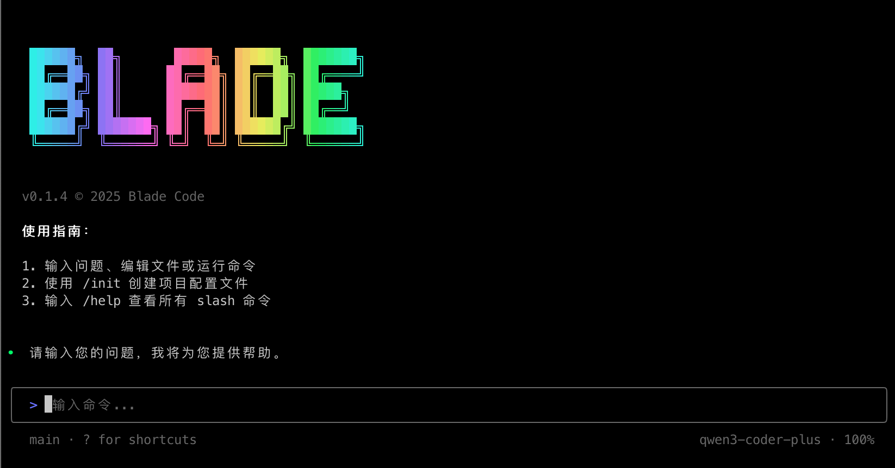

<div align="center">

# 🗡️ Blade Code

**Next-generation AI coding assistant — CLI + Web + Headless**

[](https://www.npmjs.com/package/blade-code)
[](LICENSE)
[](https://nodejs.org/)
[](CONTRIBUTING.md)

[简体中文](README.md) | English

</div>

Blade Code is an open-source AI coding assistant: an interactive CLI in the terminal, a Web UI in the browser, and Headless JSONL for scripts and CI. It unifies 38+ model providers through [pi-ai](https://github.com/nicepkg/pi-ai) and ships built-in tools, browser automation and task orchestration.

## Screenshots

<div align="center">
  
  <p><em>CLI terminal</em></p>
</div>

<div align="center">
  
  <p><em>Web UI</em></p>
</div>

## Features

- 🤖 **Many models**: OpenAI, Anthropic, DeepSeek, Google, Bedrock and 38+ providers through pi-ai, with model metadata fetched dynamically.
- 🌐 **Three modes**: CLI, Web UI and Headless JSONL, plus `blade --acp` for ACP clients such as Pilion.
- 🧠 **Automatic memory**: project knowledge persists across sessions and learns build commands, code patterns and debugging lessons.
- 🛠️ **20+ built-in tools**: file editing, code search, shell, Git and web fetch; native browser automation uses an isolated Chromium with ARIA snapshots and safe ref interactions.
- 📋 **Tasks and orchestration**: Task delegation, Goal mode, Spec/Plan, Subagents and Agent Teams, with a multi-project board for dispatch and archiving.
- 🔗 **Open extensions**: MCP, plugins, Skills and Hooks.
- 🔒 **Safety and cost**: four permission modes (default / autoEdit / plan / yolo) plus tool allow- and blocklists; tokens, cache reads and writes, and estimated cost persist per session, and `/cost` shows them any time.
- 🎨 **Modern UI**: React + Ink in the terminal, React + Vite on the web, with Thinking mode.

## Quick start

```bash
# Try it (needs Node.js >= 22.19.0)
npx blade-code

# Or install globally
npm install -g blade-code

blade                          # interactive CLI
blade web                      # Web UI
blade --headless --output-format jsonl "analyse this repository"
blade browser install          # optional Chromium for browser automation
```

The first launch opens a setup wizard: choose a provider, a model, then enter the API key.

## Configuration

The config lives in `~/.blade/config.json` (global) or `.blade/config.json` (project).

```json
{
  "currentModelId": "primary",
  "models": [
    { "id": "primary", "provider": "deepseek", "model": "deepseek-v4-pro" }
  ]
}
```

Credentials live separately in `~/.blade/auth.json` (mode `0600`) and never enter version control. Model metadata (contextWindow, maxTokens, pricing) comes from the pi-ai catalog; a custom `overrides.baseUrl` is only needed for a proxy.

## Commands

| Command | What it does |
| --- | --- |
| `blade` | Interactive CLI |
| `blade web` | Web UI |
| `blade serve` | Headless HTTP server |
| `blade --headless "..."` | Full agent loop, non-interactive |
| `blade --print "..."` | One-turn print mode |
| `blade browser install` / `status` | Install / check the Chromium used by browser automation |
| `blade mcp` / `blade doctor` | Manage MCP servers / diagnose the environment |

Inside a session: `/model add`, `/model switch`, `/cost`, `/compact`, `/btw`, `/memory list`, `/tasks` and `/goal`.

## Development

You need Node.js ≥ 22.19.0 and Bun.

```bash
git clone https://github.com/echoVic/blade-code.git
cd blade-code
bun install
bun run dev
```

Run the same checks as CI before committing:

```bash
bun run check        # biome
bun run type-check
bun run test
```

`packages/cli` is the npm package (agent core, tools, web server, Ink UI), `packages/cli/web` is the Web UI, and `docs/` holds the user documentation. More conventions are in [CONTRIBUTING](CONTRIBUTING.md).

## Documents

- [Online documentation](https://echovic.github.io/blade-doc/#/)
- [Configuration guide](docs/configuration/config-system.md)
- [Quick start](docs/getting-started/quick-start.md)
- [Contributing](CONTRIBUTING.md)

## Blade in the browser

With [Pilion Browser](https://github.com/echoVic/pilion-browser) as the ACP client, choose **Blade** in its agent panel: Pilion starts `blade --acp`, forwards your configured API key and hands its tabs to Blade as MCP tools, with approval before actions and manual takeover. Packages are on [Pilion Releases](https://github.com/echoVic/pilion-browser/releases).

## Community

WeChat: add **VIc-Forever** with "Blade" · [Discord](https://discord.gg/utXDVcv6) · [Issues](https://github.com/echoVic/blade-code/issues)

## License

[MIT](LICENSE) — Made with ❤️ by [echoVic](https://github.com/echoVic)
