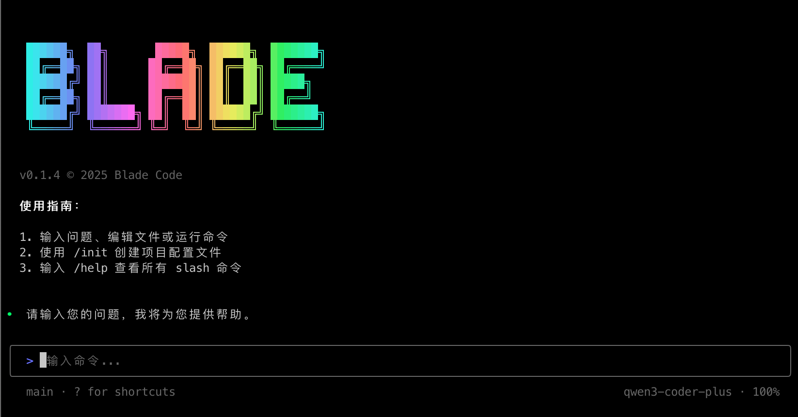

<div align="center">

# 🗡️ Blade Code

**新一代 AI 编程助手 — CLI + Web + Headless**

[](https://www.npmjs.com/package/blade-code)
[](LICENSE)
[](https://nodejs.org/)
[](CONTRIBUTING.md)

[English](README.en.md) | 简体中文

</div>

Blade Code 是一个开源的 AI 编程助手：终端里的交互式 CLI、浏览器里的 Web UI，以及给脚本和 CI 用的 Headless JSONL。基于 [pi-ai](https://github.com/nicepkg/pi-ai) 统一 38+ 模型 Provider，内置工具、浏览器自动化和任务编排。

## 界面

<div align="center">
  
  <p><em>CLI 终端界面</em></p>
</div>

<div align="center">
  
  <p><em>Web UI 界面</em></p>
</div>

## 特性

- 🤖 **多模型**：通过 pi-ai 统一 OpenAI、Anthropic、DeepSeek、Google、Bedrock 等 38+ Provider，模型元数据动态获取。
- 🌐 **三种运行模式**：CLI / Web UI / Headless JSONL，另有 `blade --acp` 供 Pilion 这类 ACP 客户端调用。
- 🧠 **自动记忆**：跨会话保存项目知识，自动学习构建命令、代码模式和调试经验。
- 🛠️ **20+ 内置工具**：文件编辑、代码搜索、Shell、Git、Web 抓取；原生浏览器自动化用隔离的 Chromium、ARIA 快照和安全 ref 交互。
- 📋 **任务与编排**：Task 委托、Goal 模式、Spec/Plan、Subagent 与 Agent Teams，多项目任务看板支持派发和归档。
- 🔗 **开放扩展**：MCP、插件、Skills、Hooks。
- 🔒 **安全与成本**：四级权限模式（default / autoEdit / plan / yolo）加工具白 / 黑名单；每轮 token、缓存读写和预估费用随会话保存，`/cost` 随时查看。
- 🎨 **现代 UI**：React + Ink 终端、React + Vite Web，支持 Thinking 模式。

## 快速开始

```bash
# 快速体验（需要 Node.js >= 22.19.0）
npx blade-code

# 全局安装
npm install -g blade-code

blade                          # 交互式 CLI
blade web                      # Web UI
blade --headless --output-format jsonl "分析这个仓库"
blade browser install          # 可选：浏览器自动化所需的 Chromium
```

首次启动会进入配置向导：选择 Provider → 选择模型 → 输入 API Key。

## 配置

配置文件在 `~/.blade/config.json`（全局）或 `.blade/config.json`（项目级）。

```json
{
  "currentModelId": "primary",
  "models": [
    { "id": "primary", "provider": "deepseek", "model": "deepseek-v4-pro" }
  ]
}
```

凭证单独存在 `~/.blade/auth.json`（权限 `0600`），不会进入版本控制。模型元数据（contextWindow、maxTokens、pricing）从 pi-ai catalog 自动获取；只有使用自定义代理时才需要在 `overrides.baseUrl` 里写 Base URL。

## 常用命令

| 命令 | 说明 |
| --- | --- |
| `blade` | 交互式 CLI |
| `blade web` | Web UI |
| `blade serve` | 无头 HTTP 服务器 |
| `blade --headless "..."` | 完整 agent loop（非交互） |
| `blade --print "..."` | 单轮打印 |
| `blade browser install` / `status` | 安装 / 检查浏览器自动化所需的 Chromium |
| `blade mcp` / `blade doctor` | 管理 MCP 服务器 / 环境诊断 |

会话内还有 `/model add`、`/model switch`、`/cost`、`/compact`、`/btw`、`/memory list`、`/tasks` 和 `/goal`。

## 开发

需要 Node.js ≥ 22.19.0 和 Bun。

```bash
git clone https://github.com/echoVic/blade-code.git
cd blade-code
bun install
bun run dev
```

提交前跑和 CI 一致的检查：

```bash
bun run check        # biome
bun run type-check
bun run test
```

仓库结构：`packages/cli` 是 npm 包（Agent 核心、工具、Web 服务器、Ink UI），`packages/cli/web` 是 Web UI，`docs/` 放用户文档。更多约定见 [CONTRIBUTING](CONTRIBUTING.md)。

## 文档

- [在线文档](https://echovic.github.io/blade-doc/#/)
- [配置指南](docs/configuration/config-system.md)
- [快速入门](docs/getting-started/quick-start.md)
- [贡献指南](CONTRIBUTING.md)

## 在浏览器里使用 Blade

[Pilion Browser](https://github.com/echoVic/pilion-browser) 作为 ACP 客户端时，在 Agent 面板选择 **Blade**：Pilion 启动 `blade --acp`，转发你配置的 API Key，并把标签页作为 MCP 工具交给 Blade，全程带操作前审批和人工接管。安装包见 [Pilion Releases](https://github.com/echoVic/pilion-browser/releases)。

## 交流

微信群：添加 **VIc-Forever**，备注「Blade」· [Discord](https://discord.gg/utXDVcv6) · [Issues](https://github.com/echoVic/blade-code/issues)

## 许可证

[MIT](LICENSE) — Made with ❤️ by [echoVic](https://github.com/echoVic)
